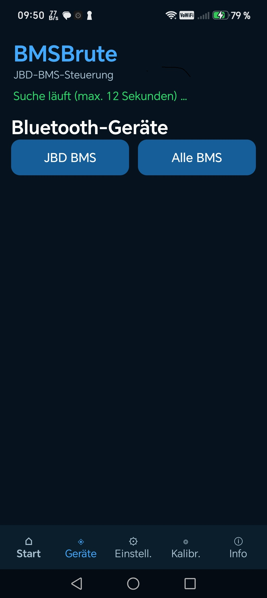
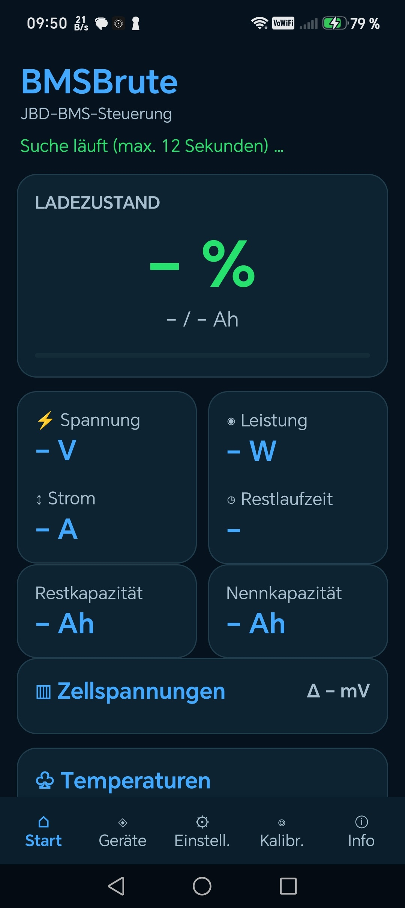
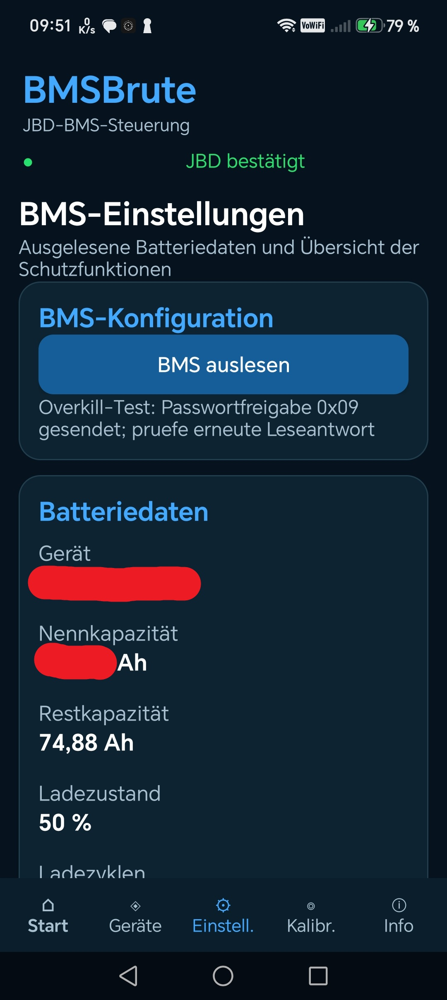
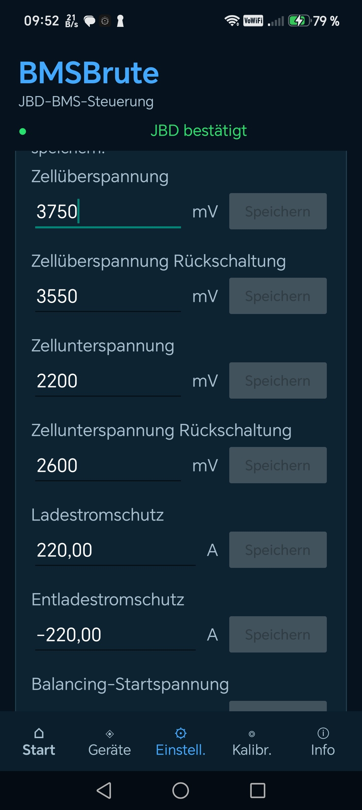
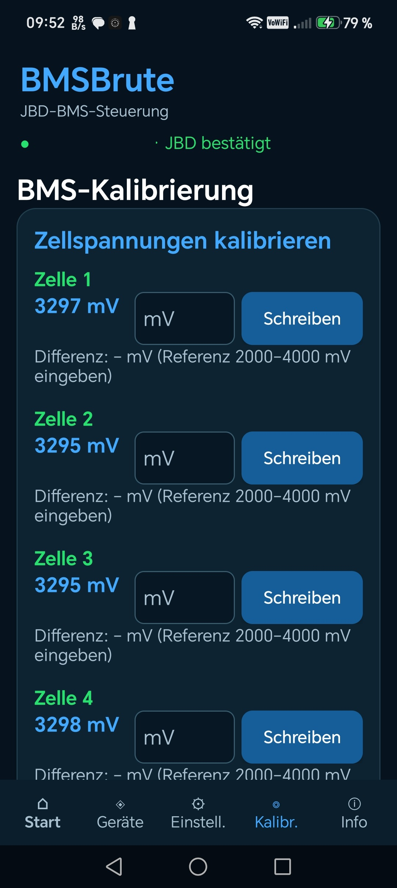
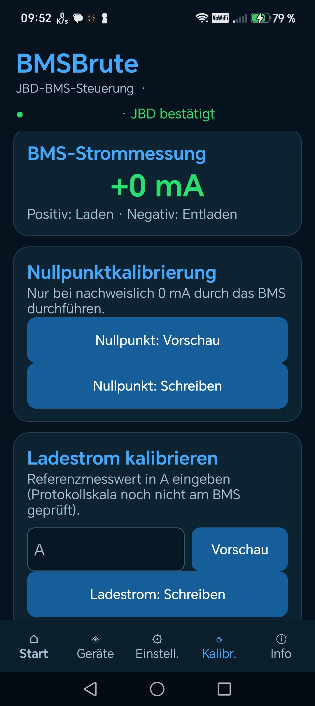
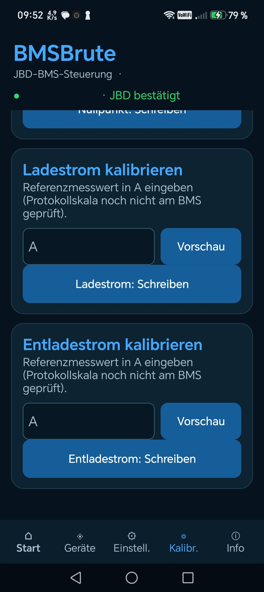

# 🔋 BMSBrute

### JBD BMS Bluetooth Tool für Android

**Batterieüberwachung · BMS-Konfiguration · Kalibrierung**

Android-Anwendung zur Kommunikation mit kompatiblen JBD-Batteriemanagementsystemen über Bluetooth.

 

### 📥 BMSBrute herunterladen

**Aktuelle Version: 0.6.4 Beta**

[Alle Versionen und Downloads](https://github.com/BMSBrute/BMSBrute/releases)

---

## 📱 Über BMSBrute

BMSBrute ist eine Android-App zur Überwachung, Diagnose und Konfiguration kompatibler **JBD Battery Management Systeme (BMS)**.

Die Kommunikation erfolgt direkt über Bluetooth.

Die Anwendung richtet sich insbesondere an technisch interessierte Anwender, die sich mit LiFePO4-Batterien und deren Batteriemanagementsystemen beschäftigen.

BMSBrute befindet sich derzeit in der öffentlichen Testphase.

## ⚡ Funktionen

### 🔵 Bluetooth-Gerätesuche

* Suche nach Bluetooth-BMS
* Filter für JBD-BMS-Geräte
* Anzeige erkannter Bluetooth-Geräte
* Verbindung mit kompatiblen JBD-BMS

### 🔋 Batterieüberwachung

* Ladezustand (SOC)
* Batteriespannung
* Lade- und Entladestrom
* Batterieleistung
* Restkapazität und Nennkapazität
* Zellspannungen
* Temperaturwerte

### ⚙️ BMS-Konfiguration

BMSBrute bietet eine Oberfläche zum Auslesen von BMS-Informationen und zur Bearbeitung unterstützter Schutzparameter.

Dazu gehören unter anderem:

* Zellüberspannung und Rückschaltschwellen
* Zellunterspannung und Rückschaltschwellen
* Ladestromschutz
* Entladestromschutz
* Balancing-Parameter

**Hinweis:** Die Verfügbarkeit und Funktionsfähigkeit einzelner Einstellungen hängt vom jeweiligen JBD-BMS-Modell und Firmwarestand ab.

### 🔧 BMS-Kalibrierung (experimentell)

Die Testversion enthält Oberflächen für:

* Kalibrierung einzelner Zellspannungen
* Stromnullpunktkalibrierung
* Ladestromkalibrierung
* Entladestromkalibrierung

**Wichtig:** Einzelne Kalibrierfunktionen sind experimentell und noch nicht vollständig an allen unterstützten BMS-Modellen überprüft.

---

# 📸 Screenshots

### Bluetooth-Gerätesuche und Batterieübersicht

  

### BMS-Einstellungen und Schutzparameter

  

### Zellspannungskalibrierung und Strommessung

  

### Ladestrom- und Entladestromkalibrierung

---

## 📲 Installation

1. Die aktuelle APK über den Download-Button herunterladen.
2. Die APK-Datei auf dem Android-Gerät öffnen.
3. Falls erforderlich, die Installation aus dieser Quelle in den Android-Einstellungen erlauben.
4. BMSBrute installieren und starten.
5. Bluetooth aktivieren und die erforderlichen Berechtigungen erteilen.

Die Anwendung wird derzeit außerhalb des Google Play Stores über GitHub bereitgestellt.

## ⚠️ Sicherheitshinweise

BMSBrute ermöglicht den Zugriff auf Funktionen kompatibler Batteriemanagementsysteme.

Falsche Einstellungen können die Schutzfunktionen einer Batterie beeinträchtigen und zu Schäden oder gefährlichen Betriebszuständen führen.

**Beachte deshalb:**

* Nur an eigenen oder ausdrücklich freigegebenen BMS verwenden.
* Vor Änderungen die ursprünglichen Einstellungen dokumentieren.
* Schutzparameter nur ändern, wenn ihre Bedeutung bekannt ist.
* Experimentelle Kalibrierfunktionen ausschließlich unter kontrollierten Bedingungen verwenden.

Die Nutzung erfolgt auf eigene Verantwortung.

---

# 🌍 English

## BMSBrute – JBD BMS Bluetooth Tool for Android

BMSBrute is an Android application for monitoring, diagnosing and configuring compatible JBD Battery Management Systems via Bluetooth.

### Main Features

* Bluetooth device discovery
* Battery status monitoring
* Cell voltage monitoring
* Battery current and voltage readings
* BMS protection parameter configuration
* Experimental cell voltage and current calibration

### Development Status

**Version 0.6.4 – Public Beta**

Some features are experimental and have not yet been fully verified across all supported JBD BMS models.

Incorrect BMS settings may affect battery safety. Use the application only with devices you own or are authorized to manage.

### Download

[Download BMSBrute v0.6.4 APK](https://github.com/BMSBrute/BMSBrute/releases/download/v0.6.4/BMSBrute0.6.4.apk)

---

### BMSBrute – Android Bluetooth BMS Tool

**JBD BMS · LiFePO4 · Bluetooth · Battery Monitoring**

Version 0.6.4 Beta | © 2026 BMSBrute

